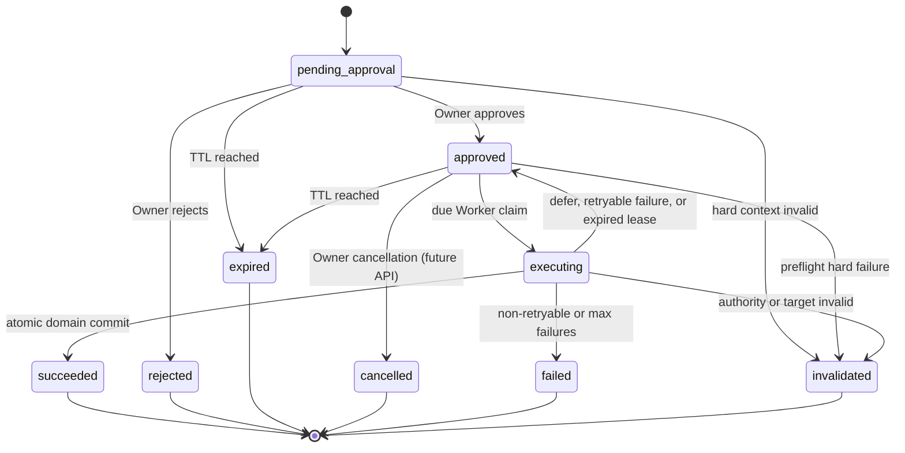

# ADR 0003: PendingAction approval and recoverable execution v1

- Status: Accepted
- Date: 2026-07-20
- Scope: Owner decision evidence, execution lease, retry recovery, idempotency and audit invariants
- Depends on: ADR 0001 API-first modular monolith, ADR 0005 transactional outbox, migration 000006

## Context

Migration 000006 established encrypted, immutable `PendingAction` commands and an
Agent-only status projection. It deliberately did not implement Owner approval or
execution. Closing that workflow introduces three failure boundaries:

1. an Owner decision may race with expiry or another decision;
2. a Worker can disappear after claiming an action;
3. PostgreSQL can commit a domain write while the Worker loses the commit response.

The approval HTTP request cannot safely perform the publication inline. Owner
authentication, CSRF validation and the decision transaction belong to the API;
content publication, retry and crash recovery belong to a bounded Worker. The
database remains the source of truth for both.

The 000006 documents also contained one conflict. The walking-skeleton
architecture allowed `executing -> approved` after a lease expiry or retryable
failure, while the product permission document described retries inside
`executing`. A long-lived `executing` row cannot distinguish a live Worker from a
scheduled retry without weakening fencing, so this ADR resolves the conflict in
favour of an explicit return to `approved`.

## Decision

### 1. Owner approval records authorization; it does not publish content

The Owner API performs one short database transaction:

- lock the action through an Owner-scoped predicate;
- compare `expected_version`;
- resolve an expiry race using the database clock;
- append an `approval_transition` ActionLog;
- set immutable decision evidence, `decision_reason_code` and `decision_audit_id`;
- move `pending_approval` to `approved` or `rejected`;
- update the idempotency replay envelope;
- append the matching PendingAction Outbox event.

The API then returns. It never decrypts and executes a command as part of an
approve mutation. List responses never decrypt commands; an Owner-scoped detail
read may decrypt a preview after the ownership predicate succeeds and records a
`sensitive_read` audit event.

`decision_audit_id` is nullable at the database level only for a rolling upgrade
from 000006. Every Phase 3 Owner decision writer must populate it. A deferred
constraint trigger verifies that the referenced ActionLog is an
`approval_transition` for the same Owner, Agent and PendingAction.

Decision reasons are controlled codes, never free text. Approval uses only
`owner_approved`. Rejection uses one of `owner_rejected`, `needs_revision`,
`insufficient_evidence`, `risk_not_accepted` or `no_longer_needed`. The
referenced ActionLog must carry the same reason code. This keeps UI choices,
audits and API replay deterministic without turning unpublished research or an
Owner's prose into metadata.

### 2. State machine



Terminal states are:

```text
succeeded | rejected | expired | cancelled | failed | invalidated
```

Terminal rows are immutable. `terminal_at` is written exactly once in the same
transaction as every terminal transition. `completed_at` is reserved for an
attempt that actually ran and ended in `succeeded` or `failed`.

`approved` is a scheduled state. It always has a non-null `next_attempt_at` that
is earlier than `expires_at`. A fresh approval defaults it to the database clock.
Temporary rate or quota pressure returns the acquired lease to `approved` and
changes `next_attempt_at`. It creates immutable lease evidence, but does not
consume the separate failure budget.

`executing` represents exactly one current lease. Returning to `approved` clears
`executing_at`, heartbeat and current lease fields. The durable
`pending_action_attempts` row preserves that execution evidence.

### 3. Claim, lease and fencing

A Worker may claim only an action satisfying all of:

```text
state = approved
next_attempt_at <= clock_timestamp()
expires_at > clock_timestamp()
attempt_count < configured maximum
failure_count < 20
```

The claim transaction:

- generates a cryptographically random 32-byte lease token in Worker memory;
- stores only its SHA-256 digest;
- changes `approved -> executing`;
- increments `attempt_count` by exactly one;
- sets `executing_at`, lease owner, lease expiry and heartbeat;
- creates attempt history through the database transition trigger.

Every heartbeat and completion uses this full fence:

```text
action_id
state = executing
attempt_count
lease_owner
lease_token_digest
lease_expires_at > clock_timestamp()
```

`PendingAction.version` is not a fencing generation. Heartbeats advance version,
so using it as the execution fence would reject the live Worker or allow code to
confuse a heartbeat with a new attempt. `attempt_count` is the lease generation.
It is monotonic and has a high integer safety bound (2,000,000,000), not the
retry budget. `failure_count` is the bounded retry budget and may reach at most 20. A claim never increments `failure_count`.

The database trigger makes lease owner, token digest, attempt number and
`executing_at` immutable during a heartbeat. Heartbeat and lease expiry are
monotonic. A stale Worker therefore cannot replace the current fence even if it
issues an update without the correct application predicate.

The database clock is authoritative for due time, expiry and lease decisions.
Process clocks are used only for local scheduling hints.

### 4. Retry and reaper semantics

The Worker reaper selects bounded batches with `FOR UPDATE SKIP LOCKED`.

- An expired `pending_approval` or `approved` action becomes `expired`.
- An expired `executing` lease consumes one failure and becomes `approved` with
  a bounded backoff when the failure budget and TTL remain.
- The same lease becomes `failed` after the twentieth real failure or when no
  valid retry can occur before action expiry.
- A permanently invalid credential, scope, account, policy hard rule, community,
  target or expected resource version becomes `invalidated`.

Retryable execution failures also use `executing -> approved`, increment
`failure_count`, and use exponential full jitter based on the resulting failure
number, capped by Worker configuration. The delay is persisted in
`next_attempt_at`.

Rate and quota pressure has an explicit `defer` disposition. Whether discovered
before work or after a lease was acquired, it does not increment
`failure_count`; a post-claim defer ends that attempt with outcome `deferred` and
persists its not-before time. Therefore repeated capacity deferrals cannot turn
the twentieth lease generation into `failed`. They remain bounded by action TTL
and the high fence-generation safety limit.

`pending_action_attempts` records one row per acquired lease. Its identity,
lease owner, token digest and claim time never change. While active, only lease
expiry and heartbeat may advance. Once finished, outcome and timing evidence are
immutable; optional audit pointers may be filled once.

### 5. Idempotency identity and final resource identity are separate

`idempotency_records.pending_action_id` identifies the durable authorization
workflow. `resource_id` identifies the domain resource produced by the logical
operation. They must not overload one column.

Canonical lifecycle:

| Logical state              | `status`           | `pending_action_id` | `resource_id` |
| -------------------------- | ------------------ | ------------------- | ------------- |
| waiting or executing       | `pending_approval` | action ID           | null          |
| published                  | `succeeded`        | action ID           | content ID    |
| rejected/expired/cancelled | `denied`           | action ID           | null          |
| failed/invalidated         | `failed`           | action ID           | null          |

For rolling compatibility, an older 000006 API replica may set
`resource_id=action ID` when creating a PendingAction. Migration 000007 backfills
`pending_action_id`; the idempotency update trigger permits the legacy resource
value to change exactly once during `pending_approval -> succeeded|denied|failed`.
No other non-null resource identity can be rewritten.

The same-key replay envelope is updated on externally meaningful transitions.
Heartbeats do not rewrite it. A terminal action and its terminal idempotency
result are committed together.

### 6. Attempt and transition audit

Owner approve/reject decisions continue to use `approval_transition`, including
the authenticated Owner, `authentication_assurance`, request ID and controlled
reason code.

Claims, retries, lease recovery and Worker terminal transitions use the new
`pending_action_transition` ActionLog class. This class requires the same Owner,
Agent and PendingAction target, original `require_approval` decision and a
controlled reason code. It must not invent an Owner approver. Capacity deferrals
use `rate_or_quota_deferred`; true retries use `retry_scheduled` or
`lease_expired`.

Heartbeats do not append ActionLogs; doing so would turn a liveness mechanism
into an unbounded audit stream. Attempt history retains their monotonic timing.

ActionLog, Outbox and public error payloads contain IDs, enums, timestamps and
controlled reason codes only. They never contain the frozen plaintext,
ciphertext, raw lease token, idempotency key, stack trace or exception message.

### 7. Atomic publication boundary

The successful execution transaction must verify the live fence and atomically
write all of:

- content and immutable revision data;
- mappings and actual write-quota consumption;
- content Outbox event and domain-write ActionLog;
- PendingAction resolved Outbox event and transition ActionLog;
- `PendingAction=succeeded` and result IDs;
- attempt outcome;
- terminal idempotency response and final `resource_id`.

The publication ActionLog keeps top-level `decision=require_approval`, because
the frozen command was authorized by the Owner approval workflow. Its
`authorization_snapshot` contains both the original approved policy/decision
evidence and a `live_revalidation` result from the current policy. This preserves
the historical authorization fact without implying that an old policy was the
live execution decision after policy changes.

If the fence predicate affects zero rows, the entire transaction rolls back.
The Worker must not call the public Agent write endpoint: the original key would
replay `pending_approval`, while a new key could create duplicate content.

After an ambiguous connection failure at commit, the Worker first rereads the
PendingAction and idempotency result. It schedules a retry only when success is
not already committed.

### 8. Error taxonomy

Database `PendingAction.error` is an exact public object, not an internal error
container:

| State         | Public code               |
| ------------- | ------------------------- |
| `rejected`    | `ACTION_REJECTED`         |
| `expired`     | `ACTION_EXPIRED`          |
| `cancelled`   | `ACTION_CANCELLED`        |
| `failed`      | `ACTION_EXECUTION_FAILED` |
| `invalidated` | `ACTION_INVALIDATED`      |

Internal retry causes belong in controlled attempt/audit reason codes and
structured operational logs. Raw `Error.message` and stack data never enter the
database public projection.

## Consequences

- Approval latency no longer holds an HTTP connection open.
- Worker replicas can compete safely without a singleton deployment.
- A crash can cause another attempt but cannot authorize two committed writes.
- Retry recovery is observable and queryable instead of hidden inside a stale
  `executing` row.
- Migration 000007 must deploy before Phase 3 API and Worker code. During rollout,
  old API creation remains compatible; no Worker may be enabled until every
  replica reports the 000007 readiness contract.
- Cancellation remains represented in the schema but its Owner API is outside
  the first approve/reject slice.
